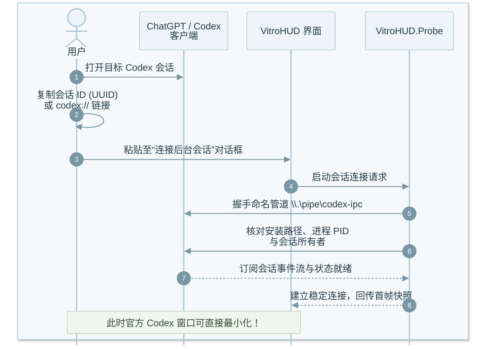
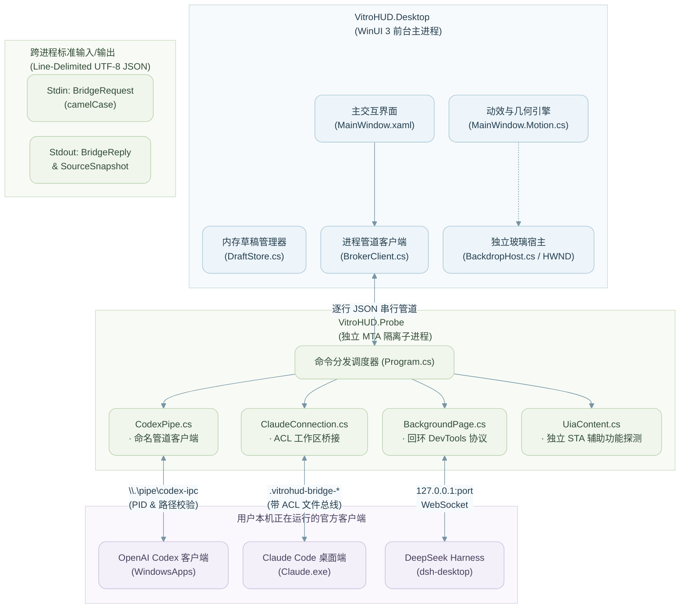
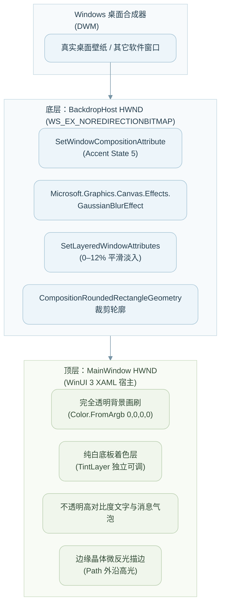
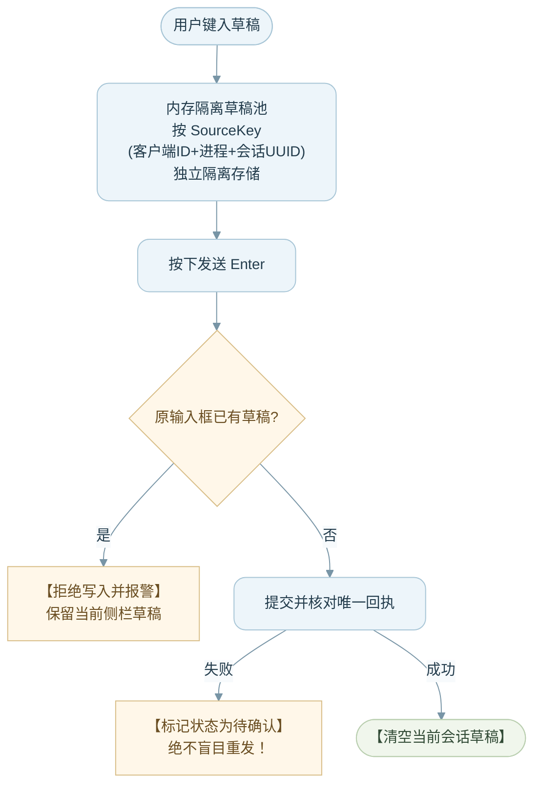

<div align="center">


<h1>VitroHUD · 灵动玻璃 AI 桌面投射终端</h1>

<p><strong>把已有的官方 AI 客户端会话，优雅投射到 Windows 桌面的原生流体玻璃侧栏</strong></p>

[](CHANGELOG.md)
[](https://www.microsoft.com/windows)
[](#compatibility)
[](LICENSE)

[](https://learn.microsoft.com/en-us/windows/apps/winui/winui3/)
[](https://dotnet.microsoft.com/)

[](https://github.com/microsoft/Win2D)
[](#architecture)

<p align="center">
  <b>无需配置 API Key</b> · <b>零额外 Token 费用</b> · <b>原生后台双向透传</b> · <b>双 HWND 液态亚克力</b> · <b>微缩悬浮胶囊</b>
</p>

</div>

VitroHUD 是独立的社区开源项目，与 Anthropic、OpenAI、DeepSeek 及 Microsoft 没有官方关联。客户端和订阅服务仍受各自条款约束。

---

## 💡 为什么是 VitroHUD？

日常使用 Claude Code、ChatGPT / Codex 或 DeepSeek 时，你是否经常遇到这些困扰：

- 官方桌面客户端窗口庞大，极度遮挡代码编辑器与工作区；
- 市面上的第三方 HUD / 悬浮窗工具几乎都要自备商业 API Key，无法使用已付费订阅的高级权限（如 Claude 思考模式、Codex 专属工具环境、ChatGPT 最新推理模型），还要为重复 Token 产生巨额账单；
- 浏览器标签页无法优雅置顶、快捷呼出，切回桌面应用极易打断工作流。

**VitroHUD 为解决这些痛点而生。**

它采用纯本机进程桥接技术，直接连接宿主机上已经登录、正在运行的官方桌面客户端。**不走任何第三方中间代理服务器，不伪造任何身份，不调用模型收费 API**。它将现有会话以轻量、通透的玻璃侧栏悬浮于屏幕边缘。即便原客户端最小化或退入后台，依然可以在 VitroHUD 中实时查看消息流、换行输入、无损保留缩进、切换模型并调整深度思考（Effort）等级。

> ⚠️ **测试版状态说明（Beta 0.1.17）**
>
> 当前版本处于活跃迭代的 Public Beta 阶段，尚未达到稳定版验收标准。本项目的本机适配依赖特定官方客户端的内部通道、安装路径及运行模式，若原客户端发生大版本升级，可能需要调整适配器代码。最新全量客户端兼容性复测记录来自 `0.1.8`；`0.1.17` 已补测 DeepSeek 最小化后的单次双向收发，细节见下方 [测试版兼容性矩阵](#compatibility)。

---

## 目录

- [💡 为什么是 VitroHUD？](#-为什么是-vitrohud)
- [✨ 核心特性与设计美学](#-核心特性与设计美学)
- [📊 测试版兼容性矩阵](#compatibility)
- [🚀 快速开始与环境要求](#-快速开始与环境要求)
  - [系统与环境要求](#系统与环境要求)
  - [从源码构建（PowerShell）](#从源码构建powershell)
  - [部署到固定目录](#部署到固定目录)
- [📖 客户端连接教程（保姆级步骤）](#-客户端连接教程保姆级步骤)
  - [第一步：基础准备与界面认识](#第一步基础准备与界面认识)
  - [第二步 A：连接 ChatGPT / Codex 模式](#第二步-a连接-chatgpt--codex-模式)
  - [第二步 B：连接 Claude Code 模式](#第二步-b连接-claude-code-模式)
  - [第二步 C：连接 DeepSeek Harness](#第二步-c连接-deepseek-harness)
  - [第三步：日常操作、快捷手势与窗口控制](#第三步日常操作快捷手势与窗口控制)
- [🛠️ 深度技术架构剖析](#architecture)
  - [多进程隔离与数据拓扑](#多进程隔离与数据拓扑)
  - [代码结构与模块索引](#代码结构与模块索引)
  - [三大通信通道的底层工程实现](#三大通信通道的底层工程实现)
  - [独立双 HWND 玻璃渲染引擎](#独立双-hwnd-玻璃渲染引擎)
  - [事务级草稿保护与防重发设计](#事务级草稿保护与防重发设计)
- [🔒 本地数据、隐私与连接生命周期](#-本地数据隐私与连接生命周期)
- [🧪 自动化测试与质量守卫](#-自动化测试与质量守卫)
- [❓ 常见问题排查（FAQ）](#-常见问题排查faq)
- [📚 技术参考与平台规范](#-技术参考与平台规范)
- [开源与贡献](#open-source)

---

## ✨ 核心特性与设计美学

<table>
  <tr>
    <td width="50%" valign="top">
      <h3>🔮 双 HWND 独立液态玻璃</h3>
      <p>采用独立无交互的背景 HWND 进行桌面合成与模糊处理，文字正文与磨砂底板<b>完全分层渲染</b>。调节玻璃通透度绝不连带淡化文字对比度，彻底告别 Windows 传统透明窗口的字迹发虚问题。</p>
      <ul>
        <li><b>通透度（0–100%）</b>：纯白底板平滑过渡，0% 实心、100% 全透明；低于 50% 自动切换深色文字画刷。</li>
        <li><b>磨砂度（0–100%）</b>：低档位（0–12%）平滑淡入独立背景，常规档位由 Win2D 连续高斯模糊实时驱动。</li>
        <li><b>边缘高光（0–100%）</b>：内外双沿微晶折射高光，赋予窗口真实的晶莹质感。</li>
        <li><b>四角圆角（0–80px）</b>：全系统无级调节，窗口、高光与 DWM 裁剪边缘实时统一。</li>
      </ul>
    </td>
    <td width="50%" valign="top">
      <h3>💧 流体侧边拉手（Liquid Side Tab）</h3>
      <p>告别笨重的顶部标签栏。客户端切换由贴附在窗口侧边缘的窄竖玻璃入口承载：</p>
      <ul>
        <li><b>有机水滴过渡</b>：拉手外凸与侧栏边缘采用连续光滑贝塞尔曲面过渡，无内部硬分隔线。</li>
        <li><b>自由拖动与磁吸对齐</b>：按住拉手可上下自由调整高度；松手时根据屏幕位置<b>自动磁吸附着</b>到最近的左或右边缘。</li>
        <li><b>轻量快捷</b>：单击秒级展开客户端切换菜单，拖动防误触保护。</li>
      </ul>
    </td>
  </tr>
  <tr>
    <td width="50%" valign="top">
      <h3>💊 微缩玻璃胶囊（Glass Capsule）</h3>
      <p>工作告一段落时，随时将 HUD 收起为 <code>76 × 44</code> 逻辑像素的微缩浮动胶囊：</p>
      <ul>
        <li><b>分阶段无切损动效</b>：收起时先淡出文字内容，再收缩几何外壳（280ms）；展开时先拉伸外壳，再渐入文字（320ms），绝不产生窗口尺寸拉伸中的字迹裁切。</li>
        <li><b>物理防抖拖拽</b>：胶囊支持屏幕绝对坐标任意拖拽，内置 5px 抖动过滤；拖拽松手绝不误触发展开。</li>
        <li><b>独立位置记忆</b>：胶囊与主窗口各自独立持久化屏幕坐标，展开立即恢复原侧栏形态。</li>
      </ul>
    </td>
    <td width="50%" valign="top">
      <h3>🛡️ 事务级防御与沙盒安全</h3>
      <p>不只是美观，更是极度严谨的系统级工程实现：</p>
      <ul>
        <li><b>进程沙盒隔离</b>：UI 交互跑在 WinUI 3 前台，所有通信与 Windows UI Automation 全面隔离在 <code>VitroHUD.Probe.exe</code> 子进程中，耗时与死锁永不阻塞桌面渲染。</li>
        <li><b>原草稿防覆盖机制</b>：检测到官方输入框已有未发送草稿时，严格拒绝外部写入覆盖。</li>
        <li><b>不可靠发送零重试</b>：网络超时或响应模糊时，强制保留本地草稿并标记“待确认”，坚决不自动重发，杜绝产生垃圾上下文。</li>
      </ul>
    </td>
  </tr>
</table>

---

<a id="compatibility"></a>

## 📊 测试版兼容性矩阵

本测试记录基于开发机实际环境：三客户端实测日期为 **2026-11-01**，DeepSeek 后台收发补测日期为 **2026-11-02**。

| 客户端及已测版本 | 核心通信技术 | 已验证通过的能力 | 当前版本已知限制 |
| :--- | :--- | :--- | :--- |
| **Claude Code**<br><code>4.4212.0.0</code><br>*(Code 模式)* | **私有带 ACL 本地工作区桥接**<br>+ Renderer JS 事件调度 | • 最小化后会话持续静默同步<br>• 单次多行提交并正常接收流式回复<br>• 实时切换模型 (Sonnet / Opus) 并回读<br>• 实时切换推理深度 (Low / Med / High) | • 首次建立需在原客户端控制台执行专属连接脚本<br>• 客户端重载或退出后需重连<br>• 官方通道未开放后台强行终止生成<br>• 普通聊天模式与 Cowork 暂未适配 |
| **ChatGPT / Codex**<br><code>26.1027.3384.0</code><br>*(Codex 模式)* | **官方命名管道 IPC**<br>(<code>codex-ipc</code> 协议) | • 窗口最小化后消息稳定双向收发<br>• 模型动态切换并校验原所有者回执<br>• 推理等级 (High / Max) 动态调节<br>• 原客户端切页后会话保持固定订阅 | • 严格校验 WindowsApps 下 <code>OpenAI.Codex</code> 安装路径<br>• 普通 ChatGPT 网页/应用聊天模式未接入此协议<br>• 后台通道暂未开放中断生成接口 |
| **DeepSeek Harness**<br><code>0.2.1-rc.5</code><br>历史补充：<code>rc.3</code> | **回环专用页面桥接**<br>+ 剪贴板受控注入 | • <code>rc.5</code> / VitroHUD <code>0.1.17</code>：原窗口最小化时从侧栏单次发送，原会话确认无重复，助手回复同步回侧栏<br>• <code>rc.3</code> 历史实测：模型与推理等级切换、多行格式保留及原草稿保护 | • 必须通过“启动后台模式”建立本机页面桥接，退出客户端后需重连<br>• 本轮未重测模型/推理切换、多行发送及停止生成<br>• <code>rc.3</code> 历史实测曾遇上游 <code>TRANSPORT / Connection error</code>，不能替代本轮 <code>rc.5</code> 结果 |

> 📌 **深度测试报告**：详细的单项实测记录请查阅 [capability-tests.md](capability-tests.md)，交互细节与视觉验收记录请查阅 [design-qa.md](design-qa.md)。

---

## 🚀 快速开始与环境要求

### 系统与环境要求

| 依赖组件 | 规格要求 | 说明 |
| :--- | :--- | :--- |
| **操作系统** | Windows 10 (Build 19041+) 或 Windows 11 x64 | 推荐 Windows 11 获取最佳 DirectComposition 玻璃合成体验 |
| **.NET SDK** | **.NET 10.0.403 SDK** | 项目配置 [global.json](global.json) 允许 `latestFeature` 自动前滚 |
| **桌面技术栈** | WinUI 3 (Windows App SDK 2.6.4)<br>Microsoft.Graphics.Win2D 1.4.0 | 编译期由 NuGet 自动拉取 |
| **原客户端** | Claude Code / ChatGPT Codex / DeepSeek | 需已在本机正常安装、完成账号登录，且能进入会话 |
| **测试辅助** | Node.js (v18+) | 仅在运行桥接模拟测试时需要；运行发布产物**完全不需要 Node.js** |

---

### 从源码构建（PowerShell）

项目提供了高度自动化的 PowerShell 发布脚本 `build.ps1`，内置发布、依赖打包、自检套件以及资源完整性验证：

```powershell
# 1. 克隆代码仓库
git clone https://github.com/vvjee799-tech/VitroHUD.git
cd VitroHUD

# 2. 一键编译发布自包含 (Self-Contained) Windows x64 产物
# 脚本会自动执行编译、资源打包，并运行 Probe --self-test 26 项适配器检查
.\build.ps1

# 3. 启动生成的原生程序
.\artifacts\VitroHUD\VitroHUD.exe
```

> [!TIP]
> `build.ps1` 会优先检测 `D:\ruanjian\dotnet\dotnet.exe`，若不存在则自动回退并调用系统 `PATH` 中的 `dotnet.exe`。您也可以使用 `-Dotnet` 手动指定 SDK 路径：
>
> ```powershell
> .\build.ps1 -Dotnet "C:\Program Files\dotnet\dotnet.exe"
> ```

构建完成后的 `artifacts/VitroHUD/` 是一个**自包含绿色目录**，内部依赖已全量打包，目标机器无需单独安装 .NET 运行时：

```text
artifacts/VitroHUD/
├── VitroHUD.exe               # 主程序入口 (WinUI 3 桌面层)
├── VitroHUD.dll               # 桌面交互核心程序集
├── resources.pri              # 编译后的 XAML 资源索引
├── App.xbf / MainWindow.xbf   # 预编译 XAML 二进制界面
├── Assets/                    # 包含高分辨率玻璃 ICO、PNG 图标与胶囊素材
│   ├── VitroHUD.ico
│   ├── VitroHUD.png
│   └── WidgetMark.png
├── probe/                     # 独立的后台隔离探测引擎
│   ├── VitroHUD.Probe.exe     # IPC / 页面 / UIA 隔离工作进程
│   └── ...                    # 依赖组件
└── ...                        # Windows App SDK 原生运行时依赖
```

---

### 部署到固定目录

如果你希望构建完成后直接安装到日常使用的固定软件目录，可使用 `-Install` 开关：

```powershell
# 编译、自检并安装到默认目录 (D:\ruanjian\VitroHUD)
.\build.ps1 -Install

# 自定义安装目录
.\build.ps1 -Install -InstallDirectory "C:\Tools\VitroHUD"
```

> [!CAUTION]
> 覆盖更新正在运行的 VitroHUD 前，请务必先右键系统托盘图标点击 **“退出 VitroHUD”**，否则 Windows 会因文件句柄占用导致复制失败。

---

## 📖 客户端连接教程（保姆级步骤）

### 第一步：基础准备与界面认识

1. 打开目标官方客户端（Claude、ChatGPT 或 DeepSeek），确认已登录并能正常对话；
2. 启动 `VitroHUD.exe`；
3. 点击侧栏边缘的**窄竖玻璃拉手**，在弹出的菜单中选择目标客户端；
4. 点击输入底栏右侧的 **⚙️ 设置图标**，展开 **“窗口与连接” → “连接后台会话…”**；
5. 根据你所使用的客户端，参照下方对应的子步骤完成握手。

---

### 第二步 A：连接 ChatGPT / Codex 模式

本模式专为 OpenAI 官方 Codex 客户端打造，基于本机命名管道协议实现极速低延迟双向通信。



1. **获取会话凭证**：在官方客户端打开目标 Codex 会话，复制该会话的完整 UUID 或会话链接。支持以下标准格式：

   - 纯 UUID 字符串：`xxxxxxxx-xxxx-xxxx-xxxx-xxxxxxxxxxxx`
   - 标准协议链接：`codex://thread/xxxxxxxx-xxxx-xxxx-xxxx-xxxxxxxxxxxx`
   - 备用协议链接：`codex://threads/xxxxxxxx-xxxx-xxxx-xxxx-xxxxxxxxxxxx`

   *(注意：请勿粘贴带有 `?` 查询参数或网页版的 `https://chatgpt.com/...` 链接)*

2. **填入并绑定**：在 VitroHUD 选择 **ChatGPT**，打开连接窗口，粘贴上述 ID 或链接，点击 **“连接”**；
3. **完成握手**：侧栏瞬间同步出现该会话历史与当前模型。此时即可将官方 Codex 客户端**最小化至任务栏**，或者在原客户端中随意切换其他页面，VitroHUD 保持专属固定订阅。

---

### 第二步 B：连接 Claude Code 模式

Claude Code 拥有强大的 Agent 能力。VitroHUD 通过带 Windows 原生 ACL 保护的私有工作区文件桥接与 Renderer 事件总线相连，无需破坏客户端签名。

1. **进入目标会话**：在 Claude 桌面端恢复并进入目标 **Code 会话**；
2. **启用开发者调试支持**：若原客户端未开启开发者菜单，需在 Claude 的 Developer Config 中设置 `allowDevTools: true`（保存后彻底重启一次 Claude 客户端）；
3. **生成连接脚本**：

   - 在 VitroHUD 选择 **Claude**，打开 **“连接后台会话…”**；
   - 填入该 Claude 会话当前绑定的**本地工作目录绝对路径**（例如 `E:\my-project`，必须真实存在，不支持 UNC 网络路径或符号链接 / Reparse Point）；
   - 点击 **“生成连接脚本”**，系统会生成一段包含动态 Nonce、Session ID 与安全握手协议的 JavaScript 代码，点击 **“复制脚本”**；

4. **注入并激活**：

   - 切回 Claude 窗口，按下快捷键 `Ctrl + Alt + I`（或菜单 *Developer → Show Dev Tools*）调出开发者控制台（Console）；
   - 将复制的脚本粘贴至控制台并回车执行；*(若控制台提示防粘贴警告，按控制台提示手动输入允许即可)*；
   - 控制台打印就绪日志后，**直接关闭开发者工具窗口**（关闭 DevTools 不会中断已注册的后台桥接）；

5. **验证成功**：返回 VitroHUD，点击 **“已执行，验证连接”**。连接指示灯变绿，会话标题同步更新，Claude 主窗口即可最小化。

---

### 第二步 C：连接 DeepSeek Harness

针对 DeepSeek 官方 Electron 客户端，VitroHUD 提供了纯本机回环调试挂载机制，无需改动安装包文件。

1. **彻底退出客户端**：从系统托盘或 DeepSeek Harness 主菜单选择**彻底退出程序**（确保后台无残留进程）；
2. **启动后台托管**：在 VitroHUD 选择 **DeepSeek**，打开 **“连接后台会话…”**，点击 **“启动后台模式”**；
3. **自动拉起与回环绑定**：VitroHUD 会调用本机已安装的 DeepSeek 可执行文件，附带仅监听 `127.0.0.1` 的回环通信参数安全启动；
4. **加载会话**：在拉起的 DeepSeek 界面中点击进入你的目标会话；
5. **开始使用**：VitroHUD 自动完成 DOM 结构与受控编辑器挂钩，同步消息流。确认状态就绪后，可直接将 DeepSeek 窗口最小化。

后台模式依赖上述启动过程启用的本机页面桥接，客户端退出后需重新连接。若看到“客户端已最小化 · 尚未连接可用的后台操作方式”，请按第 1–4 步重新启动；若侧栏仍显示旧状态，确认没有待发送草稿后重启 VitroHUD，再选择 DeepSeek。以侧栏显示“已连接官方会话 · 后台模式”以及实际收发结果确认连接。

---

### 第三步：日常操作、快捷手势与窗口控制

| 操作分类 | 快捷操作 / 手势 | 行为说明 |
| :--- | :--- | :--- |
| **发送消息** | `Enter` 或 点击向上箭头 `↑` | 将内容提交到当前绑定的原会话，自动清空侧栏输入框 |
| **消息换行** | `Shift + Enter` | 在单行底栏输入框内换行，保留完美多行文本与代码缩进 |
| **模型 / 推理切换** | 点击底栏左侧 **[模型 · 推理] 胶囊** | 实时弹出原生选项菜单，选择后由后台透传给原客户端并核对回读 |
| **停止生成** | 点击停止方块 `■` | 仅在当前通道实际支持停止能力时亮起；优先推荐在原客户端停止 |
| **固定当前会话** | 点击顶部标题右侧 **图钉 📌** | 锁定当前会话源。当检测到原客户端会话被意外切换时暂停写入保护 |
| **移动主窗口** | 按住顶部**居中短横线**拖动 | 标题栏文字区和空白区为安全保护区，必须拖动中心短横线移动窗口 |
| **移动客户端入口** | 按住侧边**窄竖玻璃拉手**拖动 | 拖动时跟随指针，松手根据横向中心线**自动磁吸吸附**到左侧或右侧边缘 |
| **收起至微型胶囊** | 点击底栏 **收起图标** 或按 `Esc` | 平滑淡出正文并收缩为 `76 × 44` 悬浮微缩胶囊，释放大量桌面空间 |
| **展开与胶囊拖拽** | 单击胶囊展开 / 按住胶囊任意拖动 | 单击立即展开为完整侧栏；拖动胶囊跟随屏幕物理坐标，松手不展开 |
| **全局呼出 / 唤醒** | 默认快捷键 `Ctrl + Alt + G` | 全局任意界面一键唤醒侧栏；若冲突自动尝试 `Ctrl + Alt + Shift + G` |
| **鼠标穿透与置顶** | 设置 → 窗口与连接 → 置顶 / 穿透 | 开启穿透后鼠标事件直接穿透至底层代码窗口，由托盘或全局热键恢复 |

> [!NOTE]
> **外观实时滑块详解**：
>
> - **通透度（Transparency）**：默认 `70%`。控制纯白亚克力底板强度。`0%` 为完全实心白底，`100%` 为极致全透明底板。
> - **磨砂度（Frosting）**：默认 `45%`。控制 Win2D 高斯模糊的扩散半径，`0%` 为关闭磨砂。
> - **边缘高光（Edge Highlight）**：默认 `60%`。控制亚克力窗口外沿反射高光强度。
> - **四角圆角（Corner Radius）**：默认 `11px`（可调节范围 `0–80px`）。

---

<a id="architecture"></a>

## 🛠️ 深度技术架构剖析

### 多进程隔离与数据拓扑

VitroHUD 摒弃了单进程容易被外部 API 或 UI Automation 拖垮的弊端，采用严格的前后台双进程分工拓扑：



---

### 代码结构与模块索引

项目源码条理极其清晰，分为共享契约、桌面交互层与后台探测沙盒层：

```text
src/
├── Shared/                               # 前后台通用模块
│   ├── Contracts.cs                      # 核心协议实体 (BridgeRequest, SourceSnapshot, 能力标记)
│   ├── DraftStore.cs                     # 基于会话 SourceKey 的隔离内存草稿池
│   ├── AppPaths.cs                       # 规范化的 LocalAppData 与日志存储路径
│   └── ClientActivation.cs               # 安全的前台焦点回退策略
│
├── VitroHUD.Desktop/                     # WinUI 3 现代化桌面渲染工程
│   ├── MainWindow.xaml / .cs             # 侧栏主视图、轮询调度器、会话固定逻辑
│   ├── MainWindow.Motion.cs              # 展开/收起分阶段时间线 (CompactTimeline) 动效状态机
│   ├── MainWindow.ClientHandle.cs        # 侧边流体拉手的磁吸、拖动与几何解算
│   ├── BackdropHost.cs                   # 独立非交互 HWND 背景宿主，Win2D 亚克力合成核心
│   ├── GlassBackdrop.cs                  # SystemBackdrop 原生接入与 DesktopAcrylic 回退
│   ├── GlassInteraction.cs               # 几何碰撞、拉手水滴曲率与胶囊物理逻辑
│   ├── BrokerClient.cs                   # 子进程生命周期托管、信号量串行化与超时容错
│   ├── TranscriptRenderer.cs             # 结构化富文本渲染 (段落、代码高亮、思考折叠)
│   └── NativeWindow.cs                   # Win32 原生窗口扩展 (DWM、无框、层叠透明、热键)
│
└── VitroHUD.Probe/                       # 隔离的后台探测与适配引擎
    ├── Program.cs                        # 控制台入口、Stdin/Stdout 循环、Self-Test 守卫
    ├── CodexPipe.cs                      # 针对 OpenAI Codex 命名管道的双向协议驱动
    ├── ClaudeConnection.cs               # Claude 安全私有文件桥接与 ACL 权限配置
    ├── ClaudeBridge.js                   # 注入 Claude Renderer 执行的事件总线脚本
    ├── BackgroundPage.cs                 # DevTools Protocol WebSocket 客户端与 DOM 挂钩
    ├── PageScript.js                     # 针对 DeepSeek 页面的受控编辑器与转录解析脚本
    ├── LocalEndpoint.cs                  # 本机回环端口与所属 PID 的反查校验防劫持模块
    └── MarkdownBlocks.cs                 # 高性能 Markdown 块解析器与空白字符守卫
```

---

### 三大通信通道的底层工程实现

#### 1. OpenAI Codex 模式：原生命名管道（`CodexPipe.cs`）

- **进程与路径双重背书**：Probe 连接 `\\.\pipe\codex-ipc` 后，使用 Win32 API `GetNamedPipeServerProcessId` 提取服务端 PID，核验可执行文件必须位于 `C:\Program Files\WindowsApps\OpenAI.Codex_...` 官方沙盒路径下；
- **会话所有者鉴权**：发送 `thread-owner-discovery` 请求，确认当前会话归属的 `handledByClientId`，并核验 `supportsUntrustedAppInput: true`；
- **防发呆回执比对**：每一笔提交分配唯一的 `clientUserMessageId`，监听原管道事件流，严格比对消息回执；模型切换时传入旧值作为前置条件（CAS），防止并发状态覆盖。

#### 2. Claude Code 模式：工作区安全隔离文件桥（`ClaudeConnection.cs` + `ClaudeBridge.js`）

- **Windows ACL 权限硬化**：在当前工作目录下动态创建 `.vitrohud-bridge-[GUID]` 专用临时目录，**移除继承权限**，通过 `DirectorySecurity` 明确限制仅允许当前登录 Windows 用户及 `NT AUTHORITY\SYSTEM` 访问；
- **双向 Nonce 与过期熔断**：请求体包含 32 位高强度 Nonce、会话 UUID 与时间戳。Renderer 端 `ClaudeBridge.js` 监听文件变动，消费请求后立即清空正文；
- **原装能力复用**：直接挂钩 Claude Renderer 内部的 `api.sendMessage` 和会话模型弹层，完美保留 Claude 原生工具执行、多轮状态与代码补全能力。

#### 3. DeepSeek Harness 模式：受控剪贴板注入与 DOM 守卫（`BackgroundPage.cs` + `PageScript.js`）

- **本地端口反查防劫持**：读取客户端 `DevToolsActivePort` 后，使用 `LocalEndpoint.OwnedBy(port, pid)` 反查 TCP 端口占有者，严格保证端口归属官方进程，杜绝任何本地恶意端口伪造；
- **无损缩进写入**：针对受控富文本编辑器（如基于 ProseMirror / ContentEditable 框架）直接 `insertText` 会丢失换行与代码缩进的问题，VitroHUD 底层采用原编辑器的纯文本粘贴管道注入，保留每一个空行与缩进；
- **发送前逐字防覆写审查**：触发点击发送按钮前，执行草稿逐字一致性校验，任何差异立即终止发送。

---

### 独立双 HWND 玻璃渲染引擎

传统 WinUI 3 亚克力背景存在一个致命痛点：**当调高背景透明度时，上方的文字和输入框控件也会连带变透明，在复杂桌面背景下极难看清。**

VitroHUD 独创了**双 HWND 物理分层渲染方案**：



1. **底层背景宿主（`BackdropHost`）**：在系统底层创建一个独立的、无交互属性（`WS_EX_TRANSPARENT | WS_EX_TOOLWINDOW`）的伴生 HWND，置于主窗口正下方；
2. **纯粹的高斯模糊**：宿主窗口挂接 `ICompositorDesktopInterop`，利用 DirectComposition + Win2D `GaussianBlurEffect` 在硬件层实时抓取桌面背景进行连续高斯模糊；
3. **顶层 XAML 渲染（`MainWindow`）**：将主窗口背景设置为 `0x00000000` 完全透明，所有文本采用独立的实心画刷渲染；
4. **刚性轮廓同步**：当主窗口发生位移、缩放、贴边吸附或收起为胶囊时，底层 HWND 通过 Win32 `SetWindowPos` 毫秒级强同步位置、外廓与圆角剪裁区，视觉上宛如一块浑然天成的物理透光玻璃。

---

### 事务级草稿保护与防重发设计

在与 AI 交互的过程中，丢失未发送的代码段或意外重复发送请求会带来极大的挫败感。VitroHUD 在架构层面确立了三大铁律：



1. **会话草稿严格隔离（`DraftStore.cs`）**：切换 Claude、ChatGPT 或 DeepSeek 时，未发送的草稿保存在各自会话独立的内存槽位中，切页绝不串话、绝不丢失；
2. **原客户端草稿绝对优先保护**：若用户曾在官方客户端输入框留下草稿，VitroHUD 会立即放弃本次覆盖发送，防止冲掉未保存内容；
3. **模糊状态绝不盲目重发**：一旦遇到网络波动、上游客户端断开连接或 9 秒超时，VitroHUD 统一抛出 `“提交结果待确认”` 警告，保持当前文本框草稿原封不动，杜绝自动化脚本常见的“重试死循环”。

---

## 🔒 本地数据、隐私与连接生命周期

VitroHUD 奉行**本地优先（Local-First）与最小暴露原则**，不维护庞大的本地数据库，不长期驻留用户会话历史。

| 存储路径 | 文件用途与说明 | 敏感度与清理建议 |
| :--- | :--- | :--- |
| `%LOCALAPPDATA%\VitroHUD\settings.json` | 用户的界面外观参数、窗口宽高、微调滑块与贴边偏好 | 低。无账号凭据，可安全备份 |
| `%LOCALAPPDATA%\VitroHUD\chatgpt-connection.json` | 当前绑定的 Codex 专属会话 UUID | 中。仅含会话 ID，不含聊天正文 |
| `%LOCALAPPDATA%\VitroHUD\claude-connection.json` | 当前绑定的 Claude 会话 ID、本地工作区路径及临时 Nonce | 中。包含本地工作区绝对路径 |
| 用户工作区 `\.vitrohud-bridge-*` | Claude 临时请求与响应中间文件 | **即用即焚**。通信消费后立即置空 |
| `%TEMP%\VitroHUD-error.log` | 桌面层与子进程异常调用栈日志 | 仅在崩溃排查时使用，提交 Issue 时请脱敏 |

> [!IMPORTANT]
> **安全声明**：VitroHUD 绝不会向外部网络发送您的会话内容、模型输出或系统隐私；向 GitHub 提交 Issue 或日志时，请注意检查并剔除包含个人目录或会话 ID 的文本。

---

## 🧪 自动化测试与质量守卫

项目内置了完备的自动化测试矩阵，覆盖几何手势、交互状态机、通信桥接与 DOM 解析，确保每一次发版的极致稳健。

在项目根目录下直接运行下列命令：

```powershell
# 1. 运行玻璃几何与手势动力学断言测试 (覆盖 516 项交互、吸附与边界状态)
dotnet run --project tests/GlassInteraction/GlassInteraction.csproj -c Release

# 2. 运行 Claude 桥接与事件调度隔离模拟测试 (基于 Node.js VM 沙盒)
node tests/claude-bridge.test.mjs

# 3. 运行构建产物自检 (包含 Probe 26 项系统级适配器守卫检查)
.\artifacts\VitroHUD\probe\VitroHUD.Probe.exe --self-test
```

- **GlassInteraction 测试套件**：涵盖拉手全屏拖拽、左右半区自动磁吸解算、5px 防抖判定、Esc 撤回、尺寸拉伸自适应及配置解析防崩溃校验；
- **ClaudeBridge 测试套件**：模拟 Claude Renderer 运行环境，校验消息防串线、UUID 路由过滤、加粗与缩进代码块提取，以及监听器泄露检测；
- **Probe Self-Test 守卫**：全自动校验各客户端命名管道安全策略、路径白名单及序列化契约。

---

## ❓ 常见问题排查（FAQ）

### Q1：为什么提示“找不到客户端”或“一直等待连接”？

- **排查步骤**：
  1. 确认官方客户端已经打开并停留在可用会话页面；
  2. 确认安装路径是否为官方正版分发版本（如 Codex 需为 WindowsApps 商店版，Claude 需为官方桌面版）；
  3. 点击设置底部的“连接状态与诊断”，查看当前 Probe 给出的具体拒绝原因。

### Q2：为什么可以正常读取消息，但无法发送（输入框禁用）？

- **排查步骤**：
  1. 查看侧栏底部的能力标志指示；
  2. 检查原官方客户端是否正处于“正在生成（Thinking / Generating）”状态或正在等待工具授权；
  3. 检查原客户端输入框是否已被手动输入了草稿内容（VitroHUD 触发了防覆盖保护）。

### Q3：执行 Claude 连接脚本时控制台报防粘贴警告怎么办？

- 现代 Electron 客户端在开启 DevTools Console 时会默认拦截外部粘贴以防钓鱼攻击。根据控制台提示在输入框内键入允许粘贴的指令（如 `allow pasting`）并回车，之后重新粘贴脚本执行即可。

### Q4：收起成小胶囊后，怎么恢复原来的侧栏？

- 直接**单击**浮动的小胶囊，侧栏即可展开；若按住胶囊进行拖拽，松手后将维持胶囊状态并自动记忆当前拖拽位置。

### Q5：为什么开启“磨砂度”滑块后，感觉模糊效果没有变化？

- 在不支持硬件级 DirectComposition 模糊的显卡或精简版 Windows 系统上，VitroHUD 会自动平稳回退至系统的 `DesktopAcrylicController` 模式（此时磨砂度由系统固定，滑块将安全禁用，防止引起视觉撕裂）。

---

## 📚 技术参考与平台规范

- [WinUI 3 官方文档](https://learn.microsoft.com/en-us/windows/apps/winui/winui3/)：Windows 现代应用开发与 XAML 界面系统
- [Microsoft Win2D 官方仓库](https://github.com/microsoft/Win2D)：DirectX 硬件加速 2D 绘图与高斯模糊滤镜
- [Windows UI Automation 体系规范](https://learn.microsoft.com/en-us/dotnet/framework/ui-automation/ui-automation-overview)：跨进程界面探测标准
- [Windows 命名管道（Named Pipes）通信](https://learn.microsoft.com/en-us/dotnet/standard/io/how-to-use-named-pipes-for-network-interprocess-communication)：本机低延迟 IPC 架构指南
- [Windows 桌面亚克力与材质合成](https://learn.microsoft.com/en-us/windows/apps/develop/ui/system-backdrops)：`SystemBackdrop` 与 DWM 表面控制

---

<a id="open-source"></a>

## 开源与贡献

项目采用 [MIT 许可证](LICENSE)。构建、测试及 Pull Request 约定见 [CONTRIBUTING.md](CONTRIBUTING.md)，漏洞报告见 [SECURITY.md](SECURITY.md)，依赖及产品名称说明见 [THIRD_PARTY_NOTICES.md](THIRD_PARTY_NOTICES.md)。

公开仓库包含应用源码、图标、构建脚本与人工构造的测试样例。构建输出、客户端解包副本、本机连接数据、个人桌面截图、临时诊断和内部规划不进入源码提交。

[Windows CI](https://github.com/vvjee799-tech/VitroHUD/actions/workflows/ci.yml) 运行离线逻辑检查、桥接模拟测试及 Windows x64 自包含发布。CI 构建产物供开发验证，完整客户端兼容性范围以 [测试记录](capability-tests.md) 为准。

---

<div align="center">

**VitroHUD** · 为极致桌面生产力打造的开源工匠之作

如果这个项目对你的日常开发工作流有所启发，欢迎点亮右上角的 ⭐️ **Star** 支持作者！

</div>
